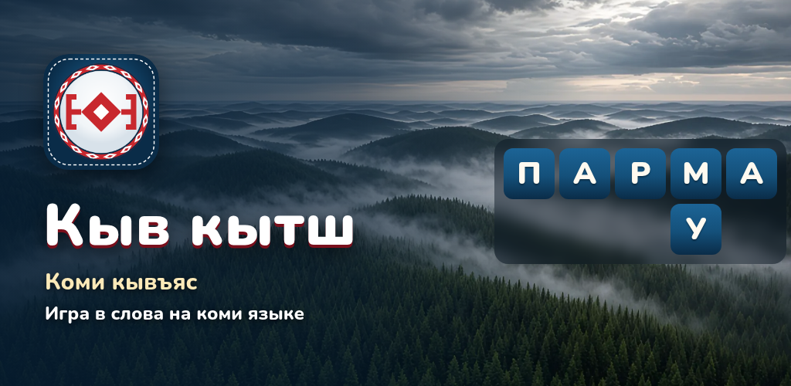
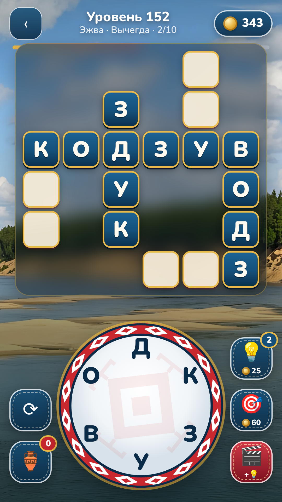
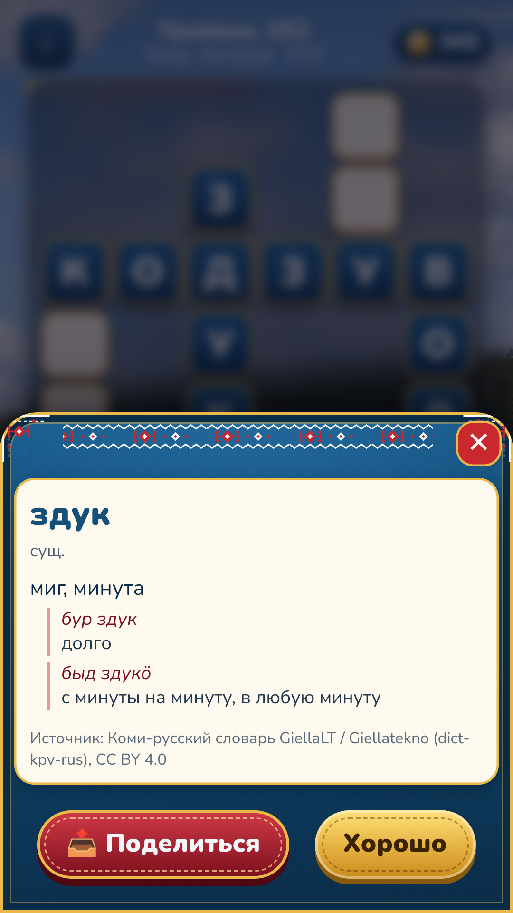
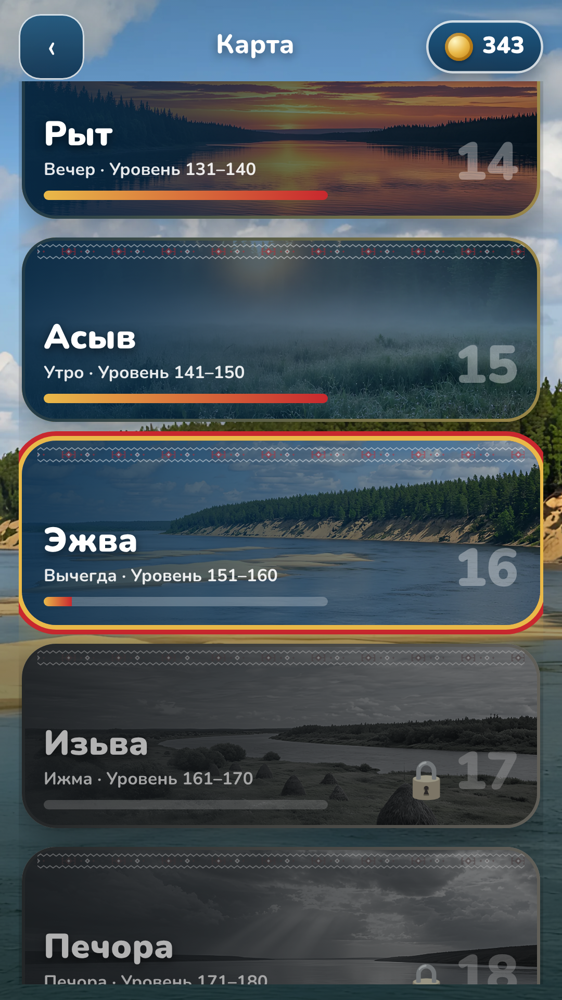
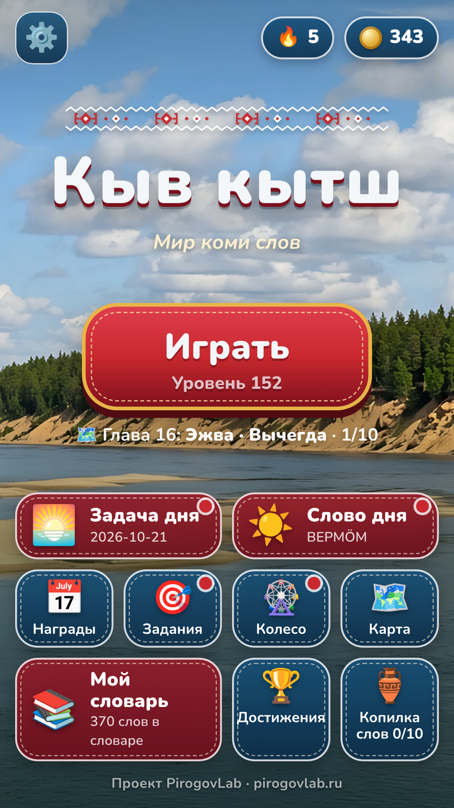

<p align="center"></p>

<h1 align="center">Кыв кытш — круг коми слов</h1>

<p align="center">


<a href="LICENSE"></a>

<a href="https://pirogovlab.ru/kyv-kytsh-igra/"></a>
</p>

<p align="center"></p>

**RU** · [EN](#english)

Словесная головоломка на коми (коми-зырянском) языке: соединяйте буквы на круге, составляйте коми слова и заполняйте кроссворд. 500 уровней в 50 главах, карточка с переводом на русский для каждого слова. Работает без интернета.

<!-- PLACEHOLDER store badges: add RuStore / Google Play / Yandex Games links when the listings are live -->

**Играть в браузере:** https://pirogovlab.ru/kyv-kytsh/ · **Страница игры:** https://pirogovlab.ru/kyv-kytsh-igra/ · **Скачать APK:** https://pirogovlab.ru/kyv-kytsh/kyv-kytsh.apk

## Возможности
- **500 уровней в 50 главах** (Видз — луг, Вӧр — лес, Парма — тайга, Эжва, Изьва, Печора, Кӧр — олень, Мойд — сказка, Сер — узор…), у каждой главы свой фон северной природы.
- Буквы **Ӧ І** прямо на колесе; порядок слов — по частоте в коми Википедии.
- **Карточки слов**: перевод, значения и примеры; «Мой словарь» с выученными словами.
- Задача дня, слово дня, ежедневная награда, задания, колесо удачи, достижения, бонусные слова и копилка.
- Интерактивное обучение; подсказки (буква, слово, перемешать).
- Платформы: веб, Android (WebView + Yandex Mobile Ads), Яндекс Игры (SDK v2).

## Скриншоты
<p>
   
</p>

## Данные
- Слова, переводы и примеры: коми-русский словарь **GiellaLT / Giellatekno** (UiT, https://github.com/giellalt/dict-kpv-rus), лицензия **CC BY 4.0**; коми статьи русского и английского Викисловаря через Wiktextract / kaikki.org, **CC BY-SA 4.0**. Поэтому `data/` распространяется под CC BY-SA 4.0 с указанием обоих источников.
- Частоты слов: коми Википедия (kv.wikipedia.org), в игру попадает только порядок уровней.
- Религиозная и ненормативная лексика исключена (`tools/religion_filter.py`, проверка `tools/scan_religion.py`).
- Подробнее: [SOURCES.md](SOURCES.md). Исходные дампы в репозиторий не входят; их скачивает `tools/fetch_sources.sh`.

## Сборка
```bash
PYTHONHASHSEED=0 python3 tools/build_game.py 500 10   # уровни и карточки (нужны дампы в src/)
python3 tools/verify_levels.py && python3 tools/scan_religion.py
cd test && npm i && node test.js && node test_tutorial.js && node dup_swipe.js
python3 tools/build_release.py yandex    # архив для Яндекс Игр (+ node test_release.js)
tools/build_android.sh                   # подписанные APK/AAB (JDK 17, Android SDK 36, Gradle 8.13)
```
Ключи подписи хранятся **вне репозитория**: `release/keys/keystore.properties` (в .gitignore) с полями `storeFile`, `storePassword`, `keyAlias`, `keyPassword`.
Рекламные блоки задаются в `android/app/src/main/res/values/ads.xml` (сейчас demo-блоки Яндекса).

Структура: `index.html`, `css/`, `js/` — игра; `data/` — уровни и карточки; `img/bg/` — фоны глав; `android/` — оболочка; `tools/` — сборка данных, фонов, релизов; `test/` — Playwright-тесты; `design/` — промо-графика; `docs/` — чек-листы релиза; `store/` — тексты и скриншоты для магазинов.

## Лицензии
- Код: MIT ([LICENSE](LICENSE)).
- Словарные данные в `data/`: CC BY-SA 4.0 (© авторы Викисловаря) + CC BY 4.0 (© GiellaLT / Giellatekno, UiT The Arctic University of Norway).
- Фоны глав (`img/bg/`) — изображения, сгенерированные ИИ. Иконка и графика © PirogovLab.

## Автор
Проект [PirogovLab](https://pirogovlab.ru) — Михаил Пирогов.

---

## English

**Kyv kytsh** (“Word Circle”) is a word puzzle in the Komi (Komi-Zyrian) language: connect letters on the wheel, build Komi words and fill the crossword. 500 levels in 50 chapters and a word card with a Russian translation for every word. Works offline. Web, Android (WebView) and Yandex Games builds. Code: MIT; dictionary data: CC BY-SA 4.0 (Wiktionary) + CC BY 4.0 (GiellaLT dict-kpv-rus).
